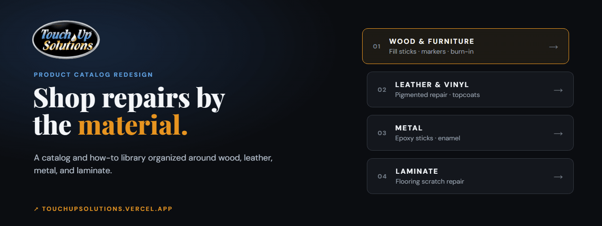
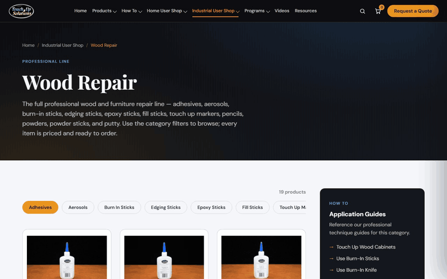
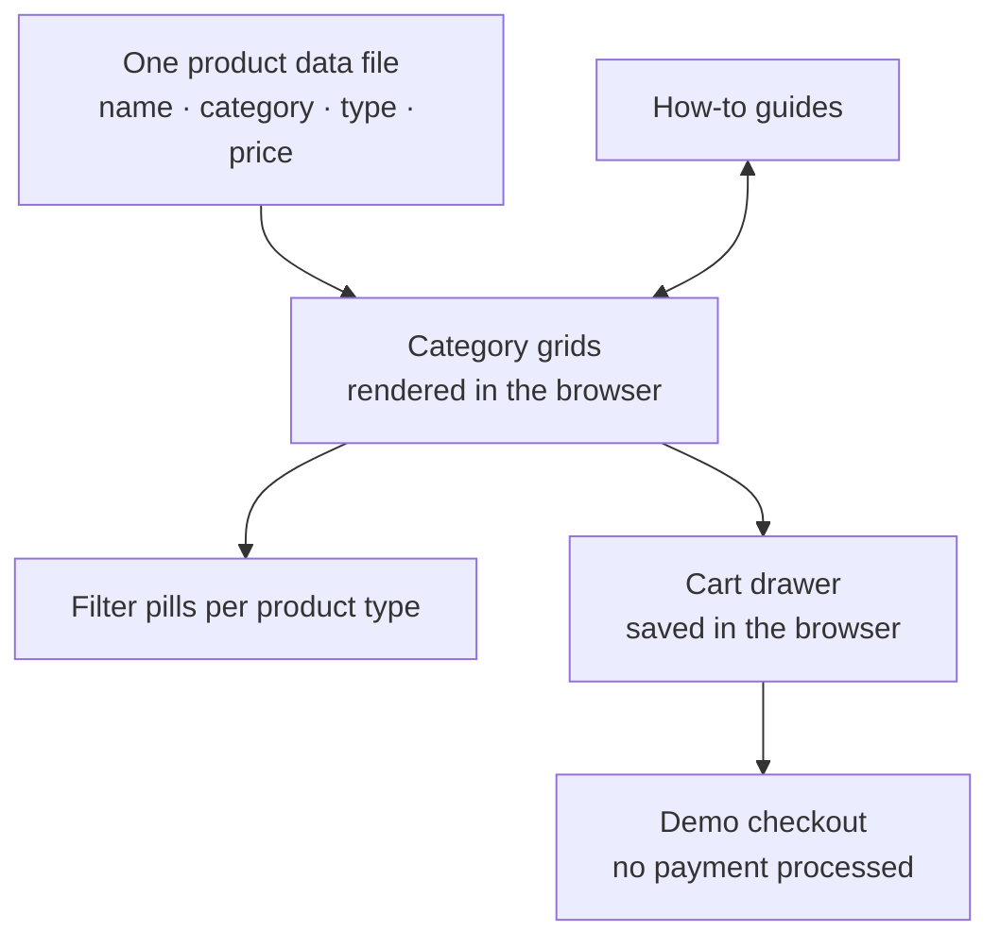
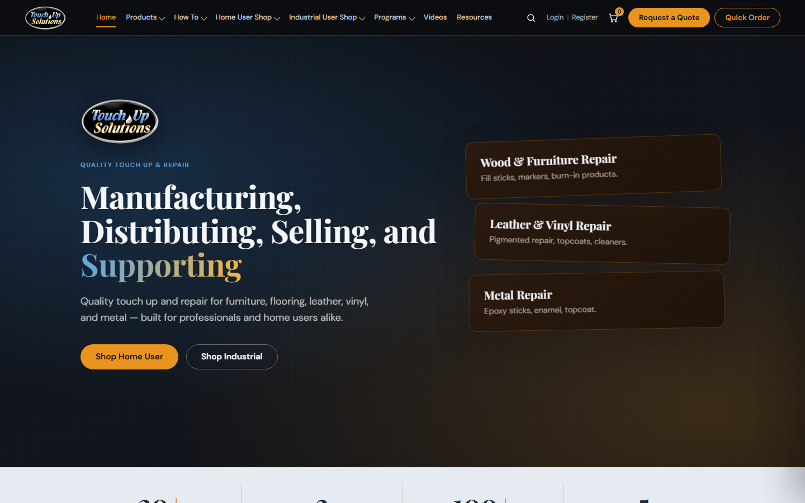
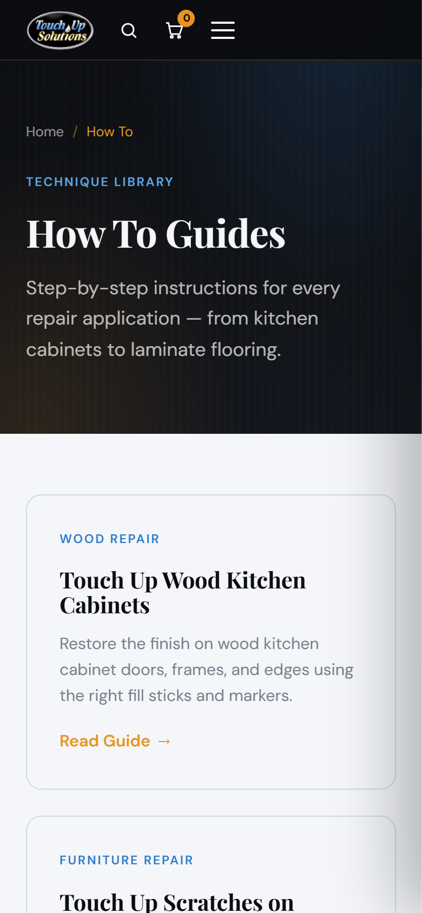
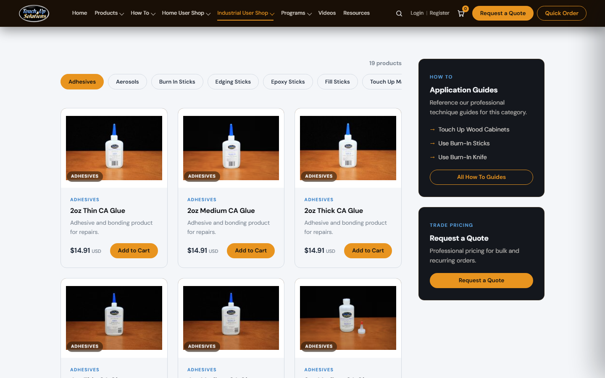

  

<h1 align="center">Touch Up Solutions</h1>

  <strong>A catalog and how-to redesign for a repair-products manufacturer, organized around the material a customer is fixing.</strong> 
  <a href="https://touchupsolutions.vercel.app"><strong>View the redesign ↗</strong></a> · <a href="https://www.higginsd.com/work/touch-up-solutions">Case study</a> · <a href="https://davishiggins.com">Davis Higgins</a>

Live redesign concept · Built by Davis Higgins and presented to Touch Up Solutions · Not the company's official website

> **What this is.** I built this redesign of the Touch Up Solutions catalog and presented it to the company's leadership. It runs at its own preview address. The company's official website is [touchupsolutions.com](https://www.touchupsolutions.com). The cart works, but checkout is a demonstration: no payment is processed.

---

## See it in motion

  

Real capture of touchupsolutions.vercel.app: from a material category into the how-to guide beside it. <a href="assets/demo.png">Static frame</a>

## What it does

- **Browse by material.** Separate shops for wood and furniture, leather and vinyl, metal, and accessories, each with filter pills for product types like adhesives, burn-in sticks, fill sticks, and markers.
- **Guides next to the products.** A how-to library (cabinets, furniture scratches, laminate flooring, burn-in tools, metal epoxy, touch-up paint) sits beside the categories it applies to, and every guide links back to the right supplies.
- **Two kinds of customer.** Distinct Home User and Industrial User shops, with a quote request and quick-order path for trade buyers.

## The problem

Touch Up Solutions makes repair products for wood, leather, metal, and laminate. That breadth is a strength in a showroom and an obstacle online. Buyers arrive knowing the material they're repairing and the job in front of them, but a broad catalog makes it hard to narrow down to the one product that fits.

The redesign structures the catalog around that starting point and puts the answers to "how do I use this?" right beside the products.

## What I built

- Information architecture across 24 pages: home, product catalog, material shops, how-to guides, programs, videos, and a resources page for safety data sheets
- A single product data file rendered into every category grid, with filter pills per category
- A persistent cart drawer and a demonstration checkout
- The visual system: dark walnut and cool-light surfaces, amber calls to action, Playfair Display and DM Sans

## How it's put together

### Engineering decisions

| Decision | Why |
|---|---|
| **Static HTML, CSS, and JavaScript** | A catalog of this size doesn't need a framework or a server. Plain static pages load fast, deploy anywhere, and are easy for the company's own team to read and maintain. |
| **One catalog file feeds every grid** | Products live in a single data file, and each category page renders its slice of it. Adding or repricing a product is one edit, not a change on every page that lists it. |
| **Guides and products link both ways** | Each category links to its technique guides, and each guide links back to the supplies it uses, so a buyer who starts in either place reaches the other in one click. |

## Screens

<table>
  <tr>
    <td width="62%"></td>
    <td rowspan="2" width="38%" align="center"></td>
  </tr>
  <tr>
    <td></td>
  </tr>
</table>

Homepage · Wood repair catalog · How-to library on mobile

## Technology

| Layer | Technology | Responsibility |
|---|---|---|
| Pages | HTML, CSS (custom properties) | 24 static pages and the design system |
| Behavior | Vanilla JavaScript | Catalog rendering, filters, cart drawer, menus |
| Hosting | Vercel | Static deployment |

## Status

- **Redesign concept.** This catalog redesign was presented to Touch Up Solutions and isn't the company's official site.
- **No payments.** The checkout page is a demonstration. Nothing is charged and no card data is stored.
- **Stack, corrected.** Earlier write-ups described this build as Next.js. The live redesign is static HTML, CSS, and JavaScript.

## About this repository

This is a documentation-only showcase. The redesign's source isn't included here.

**[View the redesign ↗](https://touchupsolutions.vercel.app)** · Built by [Davis Higgins](https://davishiggins.com) · [More of my work](https://github.com/DavisHiggins)

© 2026 Davis Higgins. Screenshots are shared for portfolio viewing. The Touch Up Solutions name, logo, and product imagery belong to Touch Up Solutions. Not an official Touch Up Solutions website.
