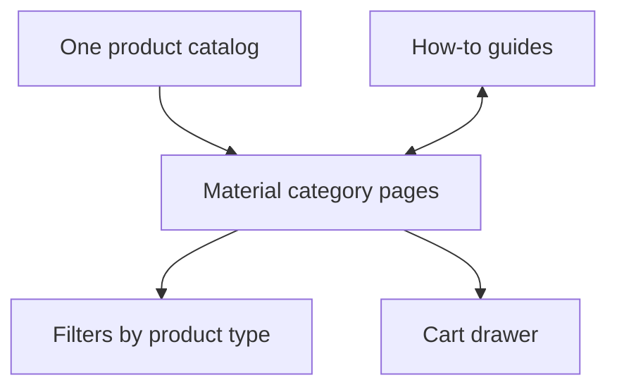

  

<h1 align="center">Touch Up Solutions</h1>

<strong>A catalog and how-to redesign for a repair-products manufacturer, organized around the material a customer is fixing.</strong>

  &nbsp;
  &nbsp;
  

Catalog redesign · Designed, built, and presented to Touch Up Solutions by Davis Higgins

---

## See it in motion

  

Real capture of touchupsolutions.vercel.app: from a material category into the how-to guide beside it. <a href="assets/demo.png">Static frame</a>

## What it does

- **Browse by material.** Dedicated shops for wood and furniture, leather and vinyl, metal, and accessories, each with filters for product types like adhesives, burn-in sticks, fill sticks, and markers.
- **Guides next to the products.** A how-to library (cabinets, furniture scratches, laminate flooring, burn-in tools, metal epoxy, touch-up paint) sits beside the categories it applies to, and every guide links back to the right supplies.
- **Two kinds of customer.** Separate Home User and Industrial User shops, with a quote request and quick-order path for trade buyers.

## The problem

Touch Up Solutions makes repair products for wood, leather, metal, and laminate. That breadth is a strength in a showroom and an obstacle online. Buyers arrive knowing the material they're repairing and the job in front of them, but a broad catalog makes it hard to narrow down to the one product that fits.

The redesign structures the catalog around that starting point and puts the answer to "how do I use this?" right beside the products.

## What I built

- Information architecture across 24 pages: home, product catalog, material shops, how-to guides, programs, videos, and a resources page for safety data sheets
- A single catalog that feeds every category grid, with filters per category
- A persistent cart drawer and checkout flow
- The visual system: dark walnut and cool-light surfaces, amber calls to action, Playfair Display and DM Sans

<strong>How it's put together</strong>

 

| Decision | Why |
|---|---|
| **Lightweight by design** | A catalog this size doesn't need heavy machinery. The pages load fast, deploy anywhere, and stay easy for the company's own team to maintain. |
| **One catalog feeds everything** | Adding or repricing a product is a single change that shows up on every page that lists it. |
| **Guides and products link both ways** | A buyer who starts with a technique or with a product reaches the other in one click. |

## Screens

<table>
  <tr>
    <td width="62%"></td>
    <td rowspan="2" width="38%" align="center"></td>
  </tr>
  <tr>
    <td></td>
  </tr>
</table>

Homepage · Wood repair catalog · How-to library on mobile

## Technology

| Layer | Technology |
|---|---|
| Pages | HTML, CSS |
| Behavior | JavaScript |
| Hosting | Vercel |

---

  &nbsp;
  

© 2026 Davis Higgins. The Touch Up Solutions name, logo, and product imagery belong to Touch Up Solutions.

